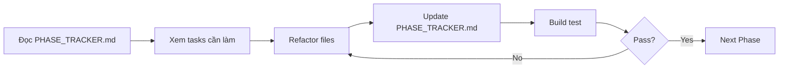

# 🏗️ GYM MANAGEMENT - REFACTORING GUIDE

> **Mục tiêu:** Refactor toàn bộ codebase để đồng bộ với SQL2 database schema đơn giản hóa

---

## 📚 BẮT ĐẦU TỪ ĐÂY

### 1️⃣ Đọc Master Plan (5 phút)
📖 **`PROJECT_ROADMAP.md`**
- Tổng quan 6 phases
- Mapping Yêu cầu dự án → Implementation
- Acceptance criteria
- **ĐỌC ĐẦU TIÊN!**

### 2️⃣ Kiểm tra tiến độ hiện tại
📊 **`PHASE_TRACKER.md`**
- Phase hiện tại: Phase 1 ✅ COMPLETED
- Files đã sửa: 11/11 entities
- Progress: 17% (11/69 files)
- **CẬP NHẬT LIÊN TỤC**

### 3️⃣ Test Phase 1
🔨 **`BUILD_INSTRUCTIONS.md`**
- Lệnh build nhanh
- Expected errors: 40-65
- Success criteria
- **CHẠY BUILD TEST NGAY**

---

## 📁 FILE STRUCTURE

```
GymManegement/
│
├── 📋 README_REFACTORING.md          ⭐ (BẠN ĐANG Ở ĐÂY)
├── 📋 PROJECT_ROADMAP.md             ⭐⭐⭐ Master plan
├── 📋 PHASE_TRACKER.md               ⭐⭐⭐ Tiến độ real-time
├── 📋 BUILD_INSTRUCTIONS.md          ⭐⭐ Build commands
├── 📋 PHASE1_BUILD_TEST.md           ⭐⭐ Phase 1 testing guide
├── 📋 PROJECT_FILES_OVERVIEW.md      ⭐ Danh sách tất cả files
│
├── SQL2/                             ✅ Database done
│   ├── 00_DROP_AND_CREATE_DB.sql
│   ├── 01_SCHEMA_SIMPLIFIED.sql
│   ├── 02_SEED_DATA.sql
│   ├── 03_STORED_PROCEDURES.sql
│   ├── README.md
│   ├── CHANGES_FOR_CODE.md           ⭐⭐ Chi tiết thay đổi code
│   ├── CODE_REFACTORING_CHECKLIST.md ⭐⭐⭐ Step-by-step guide
│   └── MIGRATION_GUIDE.md
│
├── DAL/Entities/                     ✅ Phase 1 done
│   ├── User.cs                       ✅ Major changes
│   ├── Member.cs                     ✅ Nullable + audit
│   ├── Trainer.cs                    ✅ Audit fields
│   └── ... (9 more files)            ✅ All updated
│
├── API/DTOs/                         🔜 Phase 2 next
├── DAL/Repositories/                 🔜 Phase 3
├── Service/BUS/                      🔜 Phase 4
└── Controllers/                      🔜 Phase 5
```

---

## 🎯 PHASE OVERVIEW

| Phase | Status | Files | Duration | Start Here |
|-------|--------|-------|----------|------------|
| **Phase 1: Entities** | ✅ DONE | 11 | 30 min | - |
| **Phase 2: DTOs** | 🔜 NEXT | ~25 | 1 hour | `PHASE_TRACKER.md` |
| **Phase 3: Repositories** | 🔜 | ~10 | 1.5 hour | `SQL2/CHANGES_FOR_CODE.md` |
| **Phase 4: Services** | 🔜 | ~12 | 2 hours | `SQL2/CHANGES_FOR_CODE.md` |
| **Phase 5: Controllers** | 🔜 | ~11 | 1.5 hour | `API_SPECIFICATION_SIMPLIFIED.md` |
| **Phase 6: Testing** | 🔜 | - | 2 hours | `PROJECT_ROADMAP.md` |

**Total:** 6 phases, ~69 files, ~8 hours

---

## ⚡ QUICK LINKS

### Khi bắt đầu ngày làm việc:
1. 📊 Mở `PHASE_TRACKER.md` - xem phase hiện tại
2. 📋 Mở `PROJECT_ROADMAP.md` - xem acceptance criteria
3. 🔨 Run `BUILD_INSTRUCTIONS.md` - test build

### Khi refactor code:
- **Phase 2-5:** Đọc `SQL2/CODE_REFACTORING_CHECKLIST.md`
- **Entity changes:** Xem `SQL2/CHANGES_FOR_CODE.md`
- **API changes:** Xem `API_SPECIFICATION_SIMPLIFIED.md`

### Khi có lỗi:
- **Build errors:** Xem `PHASE1_BUILD_TEST.md` (expected errors)
- **Lost track:** Quay về `PHASE_TRACKER.md`
- **Need overview:** Đọc `PROJECT_FILES_OVERVIEW.md`

---

## 🚀 WORKFLOW MỖI PHASE



### Chi tiết từng bước:

1. **Đọc Phase Tasks** (`PHASE_TRACKER.md`)
   - Xem phase hiện tại
   - Đọc acceptance criteria
   - Note files cần sửa

2. **Refactor Code**
   - Dùng `SQL2/CODE_REFACTORING_CHECKLIST.md` làm guide
   - Copy code examples nếu cần
   - Sửa từng file một

3. **Update Tracker**
   - Check ✅ files đã sửa trong `PHASE_TRACKER.md`
   - Update progress percentage

4. **Build Test**
   - Run `dotnet build`
   - So sánh error count với expected
   - Fill results vào `PHASE_TRACKER.md`

5. **Proceed or Fix**
   - Pass: Sang phase tiếp theo
   - Fail: Review và fix errors

---

## 📊 CURRENT STATUS (Bây giờ bạn đang ở đây)

### ✅ Phase 1: COMPLETED
- [x] 11 entity files updated
- [x] Deleted 2 unused entities
- [x] All match SQL2 schema
- [ ] Build test pending ← **BẠN CẦN LÀM BÂY GIỜ**

### 🎯 Next Step: BUILD TEST
1. Đọc `BUILD_INSTRUCTIONS.md`
2. Run `dotnet build` trong terminal
3. Fill results vào `PHASE1_BUILD_TEST.md`
4. Report back để tiếp tục Phase 2

---

## 🆘 TROUBLESHOOTING

### "Tôi không biết đang ở phase nào?"
→ Mở `PHASE_TRACKER.md`, xem section "Current Phase"

### "Tôi không biết phải sửa file nào?"
→ Mở `PHASE_TRACKER.md`, xem section phase hiện tại, cột "Files to modify"

### "Build bị lỗi, có đúng không?"
→ Mở `PHASE1_BUILD_TEST.md`, xem "Expected Errors" (40-65 errors là bình thường)

### "Tôi muốn xem tất cả files trong dự án?"
→ Mở `PROJECT_FILES_OVERVIEW.md`

### "Code examples ở đâu?"
→ Mở `SQL2/CODE_REFACTORING_CHECKLIST.md`

### "PowerShell không chạy được?"
→ Dùng VS Code Terminal hoặc Visual Studio IDE

---

## 🎓 KEY CONCEPTS

### Database Changes (SQL2):
- ✅ Simplified schema (10 tables)
- ❌ No RBAC tables (User.Role is string)
- ❌ No OTP verification
- ❌ No RefreshToken
- ✅ Simple 3-role system: Admin/Trainer/Member

### Auto-behaviors:
- 📝 Register → auto create Member with QRCode
- 💳 CreateMembership → auto create Invoice
- 💰 CreatePayment → auto update Invoice.Status

### Audit Fields (All entities):
- `CreatedAt` (DateTime)
- `UpdatedAt` (DateTime?)
- `IsDeleted` (bool)
- `DeletedAt` (DateTime?)
- ❌ Remove: CreatedBy, UpdatedBy, DeletedBy, RowVersion

---

## 📞 REFERENCE FILES BY TASK

| Task | File to Open |
|------|--------------|
| Bắt đầu dự án | `PROJECT_ROADMAP.md` |
| Xem tiến độ | `PHASE_TRACKER.md` |
| Build test | `BUILD_INSTRUCTIONS.md` |
| Refactor entities | `SQL2/CODE_REFACTORING_CHECKLIST.md` |
| Refactor DTOs | `SQL2/CHANGES_FOR_CODE.md` |
| Refactor repos | `SQL2/CHANGES_FOR_CODE.md` |
| Refactor services | `SQL2/CHANGES_FOR_CODE.md` |
| Refactor controllers | `API_SPECIFICATION_SIMPLIFIED.md` |
| Test API | `API_SPECIFICATION_SIMPLIFIED.md` |
| Xem tất cả files | `PROJECT_FILES_OVERVIEW.md` |
| Lost/confused | `README_REFACTORING.md` (file này) |

---

## ✅ TODAY'S CHECKLIST (2026-10-09)

- [x] Phase 1: Refactor all entities
- [x] Create documentation files
- [ ] **BUILD TEST** ← BẠN Ở ĐÂY
- [ ] Fill build results
- [ ] Report back for Phase 2

---

## 🎯 SUCCESS = 6 CORE GYM FUNCTIONS WORKING

1. ✅ **Member Registration & Management**
   - Register → auto create Member
   - CRUD members
   - QR Code generation

2. ✅ **Membership Management**
   - Create membership → auto create invoice
   - CRUD memberships
   - Active/inactive tracking

3. ✅ **Schedule & Session Management**
   - Trainer-Member schedules
   - CRUD schedules/sessions

4. ✅ **Check-in Management**
   - QR Code check-in
   - Manual check-in
   - Check-in history

5. ✅ **Invoice & Payment Management**
   - Auto invoice on membership
   - Payment → auto update invoice status
   - Payment history

6. ✅ **Reporting**
   - Member statistics
   - Revenue reports
   - Check-in reports

---

**Document Created:** 2026-10-09  
**Current Phase:** Phase 1 Complete → Build Test  
**Next Action:** Run `dotnet build` and report results
